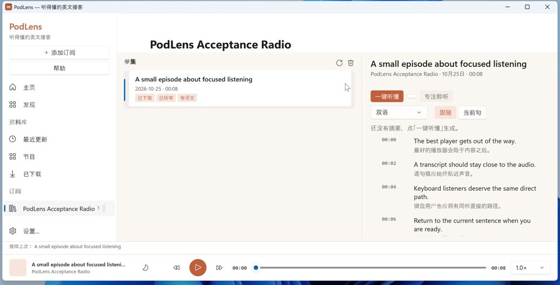
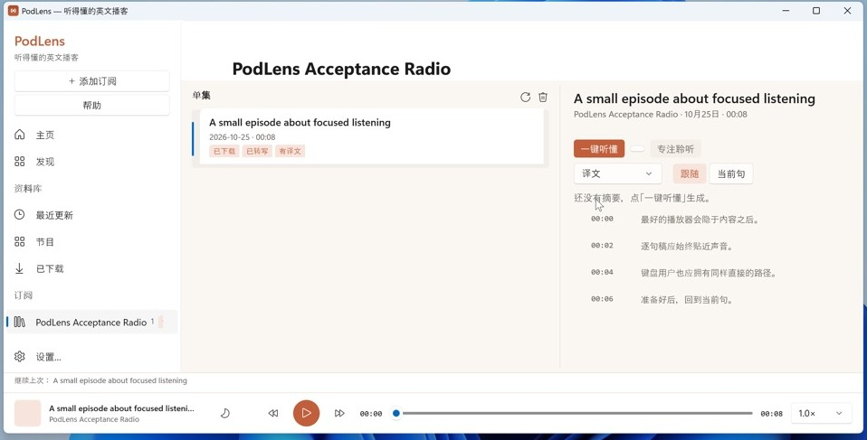
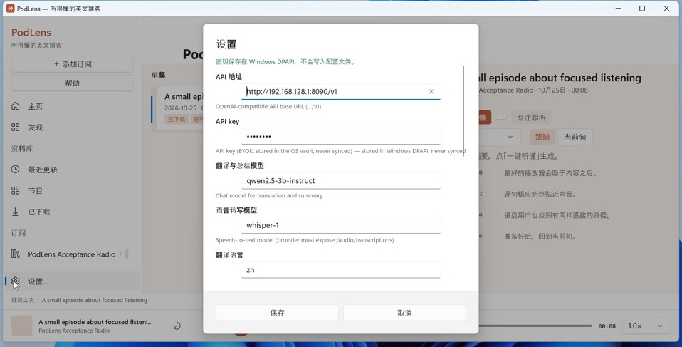
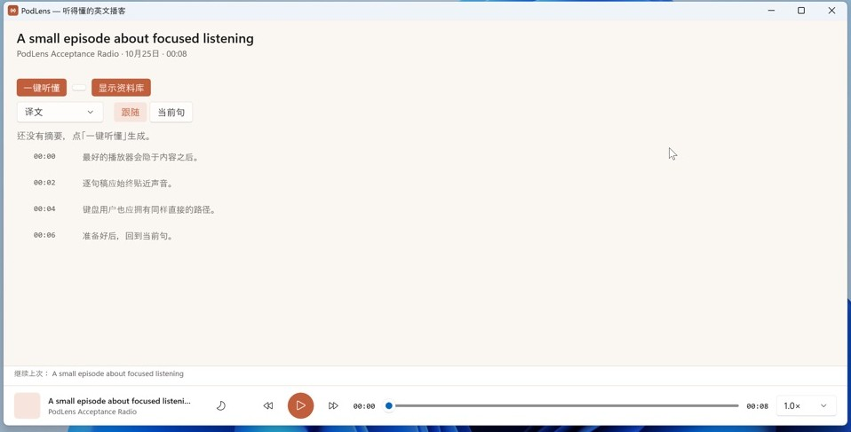
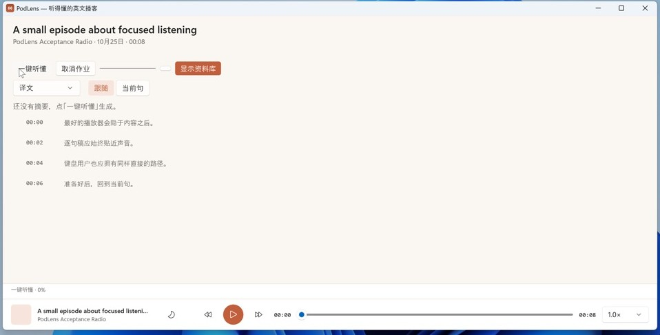

# PodLens 0.7.0 verification

Tag: `v0.7.0` (annotation on `e47554a`; parity code at `283a927`).

## CI

- Backend tests on macOS, Windows and Ubuntu: **113 passed**.
- Host builds: macOS SwiftUI, Windows WinUI, Linux GTK4.
- Packaged acceptance: macOS arm64 + x64, Windows 1024×768 UIA,
  Linux headless AT-SPI. All required suites passed.
- Release run `42338861918`: 22 assets, merged signed update manifest,
  checksums and provenance.

## VMPal (real Windows VM)

Host: **Windows 11 26H2**, build `26300.9711`, x64, VMPal virtual machine.
The published MSI was installed over the previous 0.4.0 install (per-product
upgrade), not side-loaded from a developer build.

- Registry `DisplayVersion`: **0.7.0**.
- `C:\Program Files\podlens\RivetHost.exe` FileVersion/ProductVersion:
  **0.7.0.8**.
- Page header, sidebar, episode list, reading modes, Settings, Focus
  Listening and the player bar render correctly at 1280×701.
- Settings shows the DPAPI storage note (`密钥保存在 Windows DPAPI，不会写入
  配置文件。`), human field labels and the masked key.
- Reading modes switch between **双语 / 译文 / 原文**; translation-only
  removes the original lines.
- Focus Listening removes the whole header band and fills the window.
- Starting Understand shows the progress bar and **取消作业**; pressing it
  switches the status to **正在取消…**.

| State | Evidence |
|---|---|
| Library |  |
| Translation only |  |
| Settings / DPAPI |  |
| Focus Listening |  |
| Job + Cancel |  |

## Known issue found by this pass

With the API base deliberately pointed at an unreachable endpoint, Cancel
kept the job at **正在取消…** while the in-flight OpenAI HTTP request was
blocked. The cancel flag is honoured at the next checkpoint, so a request
that never returns also never reaches that checkpoint. This is a backend
network-timeout/cancellation gap, not a Windows UI regression; it is tracked
for the next slice and does not lose already-written data. Resolved for the
UI in 0.7.5; see `VERIFICATION-0.7.5.md` for the residual worker limitation.

## Hashes

```
4d6abd653262e476df26f7ef3e3a07ad4d175f23170c777adb7fc4a6fc075866  podlens-0.7.0-windows-x64.zip
65c925039115b8baaf3c92e88e0f99d32d485a2ea3b15fac62b2ee9265a7dae1  podlens-0.7.0-windows-x64.msi
```
