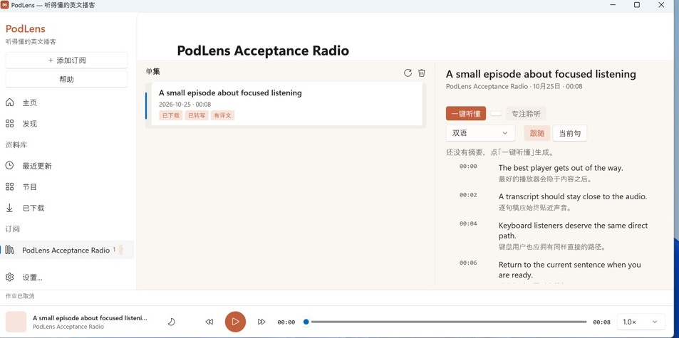

# PodLens 0.7.5 verification

Tag: `v0.7.5` (rebuild on the Rivet pin containing the RPM fix).
Latest release: <https://github.com/turlamai/podlens/releases/tag/v0.7.5>.

## What changed

`job-cancel` can be queued behind a blocking provider read inside the
embedded runtime. Every host now leaves the progress state immediately:

- Windows clears the active job, hides progress, shows `status.cancelled`,
  and invalidates the poll generation before the best-effort RPC.
- Linux clears the active job/progress before the async RPC.
- macOS removes the tracked job (stopping its poll) and shows
  `jobCancelled`.

The backend still marks a processed cancel terminal and discards late
provider results; host-side cancellation is the user-visible guarantee.

## VMPal (real Windows VM)

Published MSI installed on **Windows 11 26H2** (VMPal VM); installed
FileVersion **0.7.5.13**. Scenario: provider accepts the connection and
never answers, then Cancel.

- The progress bar and Cancel button disappear immediately.
- The status line shows **作业已取消**.
- `summary-status` can still be `running` in the library because the
  blocked socket never returned; the host no longer waits for it. This is
  the known limitation below.

| State | Evidence |
|---|---|
| Cancelled immediately |  |

## Linux x64 RPM

The earlier 0.7.5 run failed with `File not found .../opt/podlens/*`.
Rivet main already fixed the quoted `%files` glob (`f1f8c4c`, PR #431) and
moved the rpmdb into the project topdir (`021cdcd`). PodLens now pins
`b9811930`; the release produced both
`podlens-0.7.5-13-linux-x86_64.rpm` and
`podlens-0.7.5-13-linux-aarch64.rpm`.

## Known limitation

If the provider socket never returns, the worker thread can remain blocked
until the OS timeout and the stage may stay `running` on disk; the UI is
already terminal. The durable fix is to move provider I/O off the embedded
runtime thread (separate place/process), tracked as the next backend
architectural slice.
